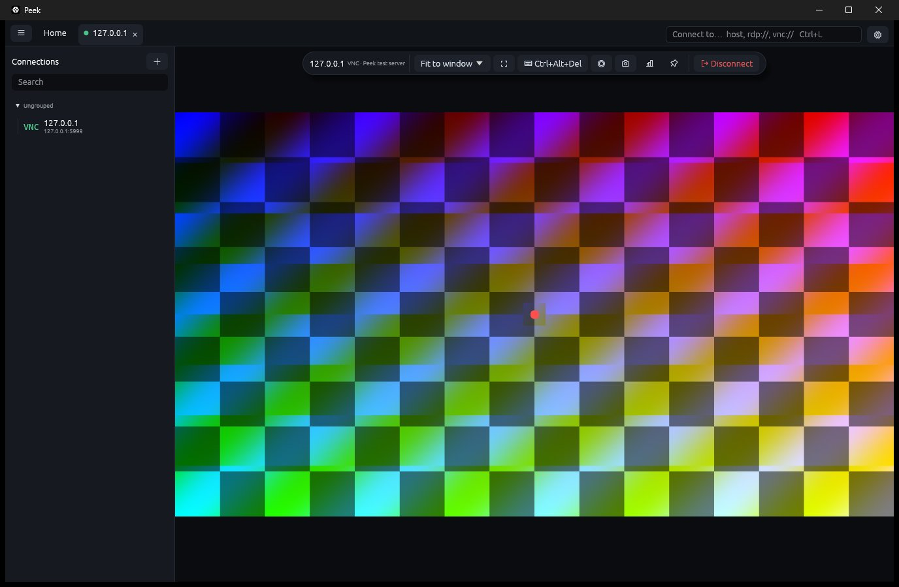

# Peek

A fast, quiet remote desktop client written in Rust with egui. RDP first, VNC second.



Website: <https://ulaas.github.io/peek/> (source in `site/`, published by `.github/workflows/pages.yml`).

## Status

Working today:

- **RDP** on IronRDP: TLS + NLA (CredSSP), RemoteFX, dynamic resize, text and file clipboard, certificate trust on first use
- **Audio** (RDP): own low-latency output in the device's native format, Opus or PCM from the server, remote volume, per-session volume and mute, speaker indicator on tabs
- **VNC**: in-house RFB 3.3–3.8 client with None/VNC auth and Raw, CopyRect, RRE, Hextile, ZRLE, Tight + JPEG decoders
- Tabs, connection library (groups, favorites, search, recent), OS keychain for passwords, `.rdp` import
- User names as `DOMAIN\user`, `user@domain` or `MicrosoftAccount\you@outlook.com` (Microsoft accounts are sent as a UPN)
- Per-connection screen size: match the window, a preset or custom (default 1920 × 1080)
- Command palette (Ctrl+K), floating session toolbar, full screen, live thumbnails of open sessions
- Keyboard grab on Windows: Windows key, Alt+Tab and Print Screen go to the remote computer
- Auto-reconnect with backoff, Wake-on-LAN, screenshot to clipboard
- Session recording (`.peekrec`: lossless picture, Opus sound) with a built-in player and MP4 export (H.264 + AAC)
- Update check once a day and one-click update, verified by checksum (see [Updates](#updates))

Not yet: SSH, RD Gateway, H.264 (EGFX).

The RDP path has not yet been tested against a live Windows host; VNC is tested end to end against the bundled test server.

## Download

Installers and portable builds for Windows (x64 `.msi`), Linux (x64 `.deb`, `.rpm`) and macOS (Apple silicon `.dmg`, preview) are on the [releases page](https://github.com/ulaas/peek/releases/latest). They are not code-signed yet; the release notes say how to get past the first-launch warning on each system.

## Updates

Peek looks for a new version once a day, when it starts, and offers it in *About* and *Settings*. **Check for updates** there, or in the command palette, asks right away.

**What Peek contacts.** The check is one HTTPS request to GitHub, `https://api.github.com/repos/ulaas/peek/releases/latest`. It carries a `User-Agent: peek/<version>` header and nothing else of Peek's: no identifier, no settings, nothing about your connections. GitHub sees the address the request comes from, as any web server does. Peek has no server of its own. Turn the daily check off under *Settings → Updates*; Peek then contacts GitHub only when you ask it to.

**What an update does.** Nothing is downloaded until you click **Update and restart**. Peek then fetches the file for its kind of install from `https://github.com/ulaas/peek/releases/`, and installs it only if its SHA-256 matches the release's `SHA256SUMS.txt` and the digest GitHub reports for the file. A restart closes open sessions, so Peek asks first when there are any. You can cancel while it downloads; if anything fails, the installed version stays as it was.

| Install | What the update does |
|---|---|
| Windows, portable zip | Replaces `peek.exe` in place and restarts. The previous one is kept as `peek.exe.old` until the next start. |
| Windows, MSI | Closes Peek, runs the new MSI (Windows asks for permission) and starts Peek again. If you decline, the previous version starts again and says so. |
| Linux, `~/.local/bin/peek` or the unpacked archive | Replaces the `peek` binary in place and restarts. |
| Linux, `.deb`, `.rpm` or AUR package | Nothing by itself: update with your package manager. Peek shows the release page. |
| macOS | Downloads and checks the new disk image and opens it; quit Peek and drag the new one to Applications. |
| Scoop, Homebrew | Nothing by itself: `scoop update peek` or `brew upgrade --cask peek`. |

A copy in a folder Peek cannot write to, and a debug build, only point to the release page. Drafts and pre-releases are never offered.

## Use

```
peek                          # open the app
peek server01                 # connect (RDP by default)
peek vnc://pi.local:1         # VNC display 1 = port 5901
peek alice@10.0.0.5:3390      # RDP with user name and port
peek Work.rdp                 # import an mstsc connection file
peek session.peekrec          # play a recording
peek --version                # version and the commit it was built from
```

| Shortcut | Action |
|---|---|
| Ctrl+K | Command palette |
| Ctrl+L | Quick connect |
| Ctrl+Alt+Enter | Full screen (works inside a session) |
| Ctrl+N / Ctrl+W / Ctrl+Tab | New connection / close tab / next tab |

Shortcuts other than Ctrl+Alt+Enter go to the remote computer while a session has focus. Click outside the session to use them locally.

## Build

```
./scripts/dev.ps1 build            # cargo build, then target/ hygiene
./scripts/dev.ps1 test --workspace
cargo run -p peek-vnc --example testserver -- 5999 [password]   # local VNC test server
cargo run -p peek-record --features mp4 --example export -- in.peekrec out.mp4 [--check frame.bmp]
```

Building needs Rust 1.90+ and CMake (for the bundled Opus); on Linux also `libasound2-dev` and `pkg-config`.

Releases: bump `version` in `Cargo.toml`, add a `## <version>` section to `CHANGELOG.md`, commit, then push a tag `v<version>`. `.github/workflows/release.yml` waits for CI (`.github/workflows/ci.yml`: fmt, clippy, tests on all three systems) to pass on that commit, then builds and publishes the release with that section as its notes. Running the workflow by hand from the Actions tab is a dry run that only uploads the packages as artifacts.

Disk use is kept in check by the build profiles (dependencies built without debug info) and `scripts/hygiene.ps1`. The script removes superseded build outputs older than 3 days and runs `cargo clean` if `target/` passes 12 GB. `dev.ps1` runs it after every cargo command.

## Layout

| Crate | Role |
|---|---|
| `peek-core` | Framebuffer with dirty rectangles, input model (scancodes, keysyms), endpoints, session contract |
| `peek-rdp` | RDP backend on IronRDP; copies only updated regions |
| `peek-vnc` | RFB client and decoders; test server example |
| `peek-record` | `.peekrec` writer and player |
| `peek-store` | Library, settings, known hosts, keychain vault, `.rdp` import |
| `peek-app` | The egui application (`peek` binary), including the update check and self-update (`update.rs`) |

Logging: set `PEEK_LOG=debug`. Rendering defaults to DX12 and the power-saving GPU on Windows; override with `WGPU_BACKEND` / `WGPU_POWER_PREF`.

Icons: [Phosphor](https://phosphoricons.com) regular and fill (MIT).
